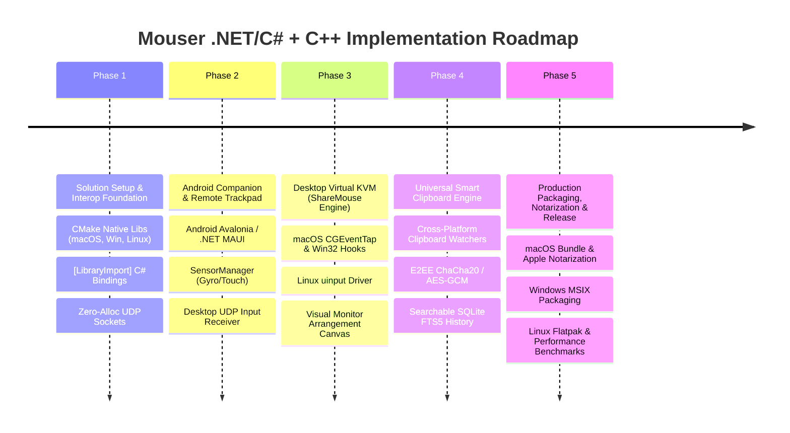

# Mouser: .NET / C# + Low-Level C++ Architecture & Comprehensive Roadmap
## Production Plan: Cross-Platform Virtual KVM & Smart Clipboard (macOS, Windows, Linux, Android)

> **Framework & Paradigm**: Modern .NET 8 / 9 + C# 12 / 13 with **MVVM** (`CommunityToolkit.Mvvm`)  
> **Low-Level Engine**: Native C++ / Objective-C++ / Win32 / C libraries accessed via high-performance Source-Generated P/Invoke (`[LibraryImport]`)  
> **UI Layer**: Cross-Platform XAML / WPF paradigm (WPF on Windows + Avalonia XAML cross-platform engine for macOS, Linux, and Android)

---

## 1. Architectural Strategy: C# .NET with Low-Level C++ Interop

This architecture combines the developer velocity, memory safety, and UI elegance of modern C# with the microsecond latency and hardware-level OS hooks of C and C++.

```mermaid
graph TD
    subgraph Presentation Layer: Modern XAML & MVVM
        WinUI[Windows: Native WPF / XAML]
        MacUI[macOS: Avalonia XAML / Metal Backend]
        LinUI[Linux: Avalonia XAML / Wayland & X11]
        AndUI[Android: Avalonia Mobile / Android Views]
        VM[Shared MVVM Core: CommunityToolkit.Mvvm<br/>ViewModels, Reactive Observables, RelayCommands]
    end

    subgraph .NET 8/9 Application Layer
        DI[Dependency Injection: Microsoft.Extensions.DependencyInjection]
        State[State Machines, Layout Matrix Math, Encryption Orchestration]
        Net[Network Manager: System.Net.Sockets / System.IO.Pipelines / QUIC]
        ClipService[Clipboard Sync Service & SQLite FTS5 History]
        Interop[Zero-Alloc Source-Generated Interop: System.Runtime.InteropServices.LibraryImport]
    end

    subgraph Native C++ Platform Shared Libraries (libmouser_native)
        MacLib["macOS: libmouser_mac.dylib (Obj-C++ / CGEventTap / IOHID)"]
        WinLib["Windows: mouser_win.dll (Win32 RawInput / SendInput / WH_MOUSE_LL)"]
        LinLib["Linux: libmouser_lin.so (libevdev / uinput / xdg-desktop-portal)"]
        AndLib["Android: libmouser_android.so (NDK / JNI / SensorManager)"]
    end

    WinUI <--> VM
    MacUI <--> VM
    LinUI <--> VM
    AndUI <--> VM
    VM <--> DI
    DI <--> State
    State <--> Net
    State <--> ClipService
    State <--> Interop

    Interop <-->|High-speed C-ABI / Spans| MacLib
    Interop <-->|High-speed C-ABI / Spans| WinLib
    Interop <-->|High-speed C-ABI / Spans| LinLib
    Interop <-->|High-speed C-ABI / Spans| AndLib
```

---

## 2. Solving the "WPF on macOS, Linux, and Android" Challenge

WPF's original implementation is tied to the Win32/DirectX subsystem. In modern .NET, there are two primary ways to run WPF-style XAML applications across all target platforms:

### The Industry Standard: Avalonia UI (Cross-Platform WPF)
- **What it is**: Avalonia is built specifically as the cross-platform realization of WPF. It shares the exact same XAML paradigm, `Binding`, `DataTemplate`, `Style`, `ControlTemplate`, and MVVM structure as WPF.
- **Rendering**:
  - **macOS**: Renders directly via Apple's **Metal** API and Cocoa window management.
  - **Windows**: Renders via **DirectX 11/12**.
  - **Linux**: Renders natively on both **Wayland** and **X11** via Skia/Vulkan.
  - **Android**: Runs natively inside an Android Activity.
- **Shared ViewModels**: The business logic and ViewModels (`CommunityToolkit.Mvvm`) are **100% shared across all platforms**.

### Hybrid Option (Strict WPF for Windows + Avalonia for macOS/Linux/Android)
If you require strict native Windows WPF on Windows:
- Put all ViewModels, Services, Interop, and Business Logic in a shared `.NET Standard 2.1` / `.NET 8` Class Library.
- Windows uses the native `net8.0-windows` WPF project.
- macOS, Linux, and Android use the Avalonia XAML project binding to the identical ViewModels.

---

## 3. macOS Requirements for .NET & Low-Level C++ Development

To develop, run, and ship this system on macOS, the following environment and technical requirements must be satisfied:

### 3.1 Development Tooling
- **.NET 8.0 or 9.0 SDK**: Native ARM64 (Apple Silicon `osx-arm64`) and x64 (`osx-x64`) runtime.
- **Xcode Command Line Tools**: `clang` and `clang++` for compiling the Objective-C++ native dynamic library (`.dylib`).
- **IDE**: JetBrains Rider (gold standard for .NET on Mac) or VS Code with the C# Dev Kit extension.

### 3.2 macOS Security, Permissions & Entitlements
Because Mouser intercepts and simulates global mouse and keyboard inputs, macOS enforces strict security sandboxing via **TCC (Transparency, Consent, and Control)**:
1. **Accessibility Permissions (`AXIsProcessTrustedWithOptions`)**:
   - The app must prompt the user to grant Accessibility permissions in *System Settings $\rightarrow$ Privacy & Security $\rightarrow$ Accessibility*.
   - Without this, `CGEventTapCreate` will fail to intercept keystrokes or mouse clicks.
2. **Input Monitoring Permissions**:
   - Required on macOS 10.15+ (Catalina and later) for global keyboard listening.
3. **App Bundle Structure**:
   ```
   Mouser.app/
   └── Contents/
       ├── Info.plist
       ├── MacOS/
       │   └── Mouser (dotnet executable)
       ├── Resources/
       │   └── Mouser.icns
       └── Frameworks/
           └── libmouser_mac.dylib (Objective-C++ hook library)
   ```
4. **Code Signing & Notarization**:
   - Binaries must be signed with an Apple Developer ID certificate via `codesign`.
   - Apple Notarization (`notarytool`) is mandatory for distributing outside the Mac App Store.

---

## 4. Low-Level C++ / C Interop Architecture (Modern .NET Best Practices)

To achieve microsecond latency and 1,000Hz polling rate without garbage-collection overhead:

### 4.1 Modern `[LibraryImport]` Source Generators
Avoid legacy `[DllImport]`. Modern .NET uses compile-time source generation:

```csharp
// Interop/NativeMethods.cs
using System.Runtime.InteropServices;

namespace Mouser.Core.Interop;

public static partial class NativeMac
{
    private const string LibName = "libmouser_mac.dylib";

    [UnmanagedFunctionPointer(CallingConvention.Cdecl)]
    public delegate void MouseMoveCallback(short deltaX, short deltaY);

    [LibraryImport(LibName, EntryPoint = "mouser_start_mouse_hook")]
    [UnmanagedCallConv(CallConvs = new[] { typeof(System.Runtime.CompilerServices.CallConvCdecl) })]
    public static partial int StartMouseHook(MouseMoveCallback callback);

    [LibraryImport(LibName, EntryPoint = "mouser_inject_mouse_move")]
    [UnmanagedCallConv(CallConvs = new[] { typeof(System.Runtime.CompilerServices.CallConvCdecl) })]
    public static partial void InjectMouseMove(int targetX, int targetY);

    [LibraryImport(LibName, EntryPoint = "mouser_check_accessibility_permission")]
    [return: MarshalAs(UnmanagedType.Bool)]
    public static partial bool CheckAccessibilityPermission();
}
```

### 4.2 Native Objective-C++ Hook (`libmouser_mac.mm`)
```objective-c
#import <Cocoa/Cocoa.h>
#import <ApplicationServices/ApplicationServices.h>

typedef void (*MouseMoveCallback)(short deltaX, short deltaY);
static CFMachPortRef g_eventTap = NULL;
static MouseMoveCallback g_callback = NULL;

CGEventRef eventTapCallback(CGEventTapProxy proxy, CGEventType type, CGEventRef event, void *refcon) {
    if (type == kCGEventMouseMoved && g_callback) {
        int64_t dx = CGEventGetIntegerValueField(event, kCGMouseEventDeltaX);
        int64_t dy = CGEventGetIntegerValueField(event, kCGMouseEventDeltaY);
        g_callback((short)dx, (short)dy);
    }
    return event; // Return NULL if we want to swallow/suppress the event (switch to remote screen)
}

extern "C" {
    bool mouser_check_accessibility_permission() {
        NSDictionary *options = @{(__bridge id)kAXTrustedCheckOptionPrompt: @YES};
        return AXIsProcessTrustedWithOptions((__bridge CFDictionaryRef)options);
    }

    int mouser_start_mouse_hook(MouseMoveCallback cb) {
        g_callback = cb;
        CGEventMask mask = CGEventMaskBit(kCGEventMouseMoved) | 
                           CGEventMaskBit(kCGEventLeftMouseDown) | 
                           CGEventMaskBit(kCGEventLeftMouseUp) |
                           CGEventMaskBit(kCGEventKeyDown) | 
                           CGEventMaskBit(kCGEventKeyUp);

        g_eventTap = CGEventTapCreate(
            kCGHIDEventTap,
            kCGHeadInsertEventTap,
            kCGEventTapOptionDefault,
            mask,
            eventTapCallback,
            NULL
        );

        if (!g_eventTap) return -1;
        CFRunLoopSourceRef runLoopSource = CFMachPortCreateRunLoopSource(kCFAllocatorDefault, g_eventTap, 0);
        CFRunLoopAddSource(CFRunLoopGetCurrent(), runLoopSource, kCFRunLoopCommonModes);
        CGEventTapEnable(g_eventTap, true);
        return 0;
    }

    void mouser_inject_mouse_move(int targetX, int targetY) {
        CGPoint target = CGPointMake(targetX, targetY);
        CGEventRef moveEv = CGEventCreateMouseEvent(NULL, kCGEventMouseMoved, target, kCGMouseButtonLeft);
        CGEventPost(kCGHIDEventTap, moveEv);
        CFRelease(moveEv);
    }
}
```

---

## 5. MVVM & C# Best Practices Specification

### 5.1 Architecture Stack
1. **CommunityToolkit.Mvvm**:
   - `[ObservableProperty]` generates `INotifyPropertyChanged` boilerplates.
   - `[RelayCommand]` generates `ICommand` implementations.
   - `WeakReferenceMessenger` for loose coupling between background network events and UI elements.
2. **Dependency Injection & Clean Architecture**:
   - Core Services registered in `IServiceCollection`:
     - `INetworkService`
     - `IInputCaptureService` (Platform-specific implementations: `MacInputService`, `WinInputService`, `LinuxInputService`)
     - `IClipboardService`
     - `ISettingsStore`
3. **Zero-Allocation Memory Patterns**:
   - Use `ReadOnlySpan<byte>` and `Memory<byte>` for all UDP packet parsing and serialization to eliminate GC pressure during 1000Hz mouse streaming.
   - `System.IO.Pipelines` for high-throughput socket reading.

### 5.2 Example ViewModel (`MonitorLayoutViewModel.cs`)
```csharp
using CommunityToolkit.Mvvm.ComponentModel;
using CommunityToolkit.Mvvm.Input;
using System.Collections.ObjectModel;

namespace Mouser.UI.ViewModels;

public partial class MonitorLayoutViewModel : ObservableObject
{
    private readonly IInputCaptureService _inputService;

    [ObservableProperty]
    private string _statusMessage = "Ready";

    [ObservableProperty]
    private bool _isSharingActive;

    public ObservableCollection<ScreenNodeViewModel> ConnectedScreens { get; } = new();

    public MonitorLayoutViewModel(IInputCaptureService inputService)
    {
        _inputService = inputService;
    }

    [RelayCommand]
    private async Task ToggleSharingAsync()
    {
        if (IsSharingActive)
        {
            await _inputService.StopCaptureAsync();
            IsSharingActive = false;
            StatusMessage = "KVM sharing paused";
        }
        else
        {
            await _inputService.StartCaptureAsync();
            IsSharingActive = true;
            StatusMessage = "KVM sharing active across connected screens";
        }
    }
}
```

---

## 6. Comprehensive Phase-by-Phase Roadmap



---

### Phase 1: Solution Architecture & Native Interop Foundation (Weeks 1 – 3)
*Goal: Establish the .NET solution, native C++ build pipelines, and zero-allocation high-speed communication.*

- [ ] **Step 1.1: Solution Structure Setup**
  - Create `Mouser.sln` with modular projects:
    - `Mouser.Core` (.NET 8 Class Library): Networking, protocols, state machines.
    - `Mouser.Native` (C/C++ CMake project): Compiles `libmouser_mac.dylib`, `mouser_win.dll`, `libmouser_lin.so`.
    - `Mouser.UI` (Avalonia XAML / WPF UI): Views, ViewModels, Theme styles.
    - `Mouser.Android` (Android application project).
- [ ] **Step 1.2: Native Interop Layer (`[LibraryImport]`)**
  - Define C-ABI function prototypes for input hooking, injection, and permissions.
  - Implement C++ mock harnesses to test P/Invoke round-trip latency.
- [ ] **Step 1.3: High-Performance Networking**
  - Implement `System.Net.Sockets.Socket` with `SocketAsyncEventArgs` for ultra-low latency UDP streaming.
  - Binary packet serialization using `MemoryPack` or raw `Span<byte>` struct casting.
- [ ] **Step 1.4: mDNS Zero-Configuration Discovery**
  - Integrate Zeroconf or Makaretu.Dns for automatic local subnet peer discovery (`_mouser._udp.local`).

---

### Phase 2: Android Companion & Remote Trackpad (Weeks 4 – 6)
*Goal: Turn an Android phone into a high-precision remote trackpad and air mouse controlling a desktop host.*

- [ ] **Step 2.1: Android UI & Sensor Capture**
  - Implement touch capture surface with high sampling rate (up to 120Hz/240Hz).
  - Implement gesture recognizers: 1-finger move/tap, 2-finger scroll, right-click, pinch zoom.
  - Connect Android `SensorManager` to capture 6-axis Gyroscope/Accelerometer data for the 3D air-mouse pointer.
- [ ] **Step 2.2: Mobile UDP Transmitter**
  - Stream delta packets (`dx`, `dy`, `scroll`, `buttons`) over UDP with sequence numbers to eliminate jitter.
- [ ] **Step 2.3: Desktop Receiver & Native Injection**
  - Desktop receives UDP packets and invokes native injection API:
    - macOS: `CGEventCreateMouseEvent` + `CGEventPost`
    - Windows: `SendInput` / `InjectSyntheticPointerInput`
    - Linux: `/dev/uinput` via native `.so`
- [ ] **Step 2.4: Verification & Latency Benchmarks**
  - Measure end-to-end network latency over 5GHz Wi-Fi (Target: $<4\text{ms}$).

---

### Phase 3: Desktop Virtual KVM (ShareMouse Engine) (Weeks 7 – 10)
*Goal: Seamless mouse/keyboard hopping across physical desktop screens (macOS, Windows, Linux).*

- [ ] **Step 3.1: Platform Native Input Capture Hooks**
  - **macOS**: `CGEventTapCreate` with event suppression when cursor transitions to remote screen.
  - **Windows**: `SetWindowsHookEx` (`WH_MOUSE_LL` and `WH_KEYBOARD_LL`) with raw input registration.
  - **Linux**: Dual path:
    - Wayland: `xdg-desktop-portal` `InputCapture` interface.
    - X11: `XRecord` hook.
- [ ] **Step 3.2: Multi-Monitor Layout Matrix Canvas (XAML / MVVM)**
  - Build interactive drag-and-drop screen canvas in XAML.
  - Support automatic screen resolution and DPI normalization (e.g. 4K Windows next to Retina Mac).
- [ ] **Step 3.3: Boundary Transition & Coordinate Warping**
  - Implement edge detection algorithm: calculate exit point $(x, y)$ on screen A and warp cursor to entry point on screen B.
  - Add configurable edge resistance / sticky corners to prevent accidental transitions.
- [ ] **Step 3.4: Keyboard & Modifier Translation**
  - Translate macOS `Command ⌘` $\leftrightarrow$ Windows `Ctrl` / `Windows ⊞` and `Option ⌥` $\leftrightarrow$ `Alt`.
  - Handle key-up/key-down state synchronizer to eliminate "stuck key" anomalies.

---

### Phase 4: Universal Multi-Format Smart Clipboard Engine (Weeks 11 – 13)
*Goal: Real-time, E2E encrypted clipboard synchronization with searchable local history.*

- [ ] **Step 4.1: Cross-Platform Clipboard Monitoring**
  - Windows: Listen to `WM_CLIPBOARDUPDATE` via `AddClipboardFormatListener`.
  - macOS: Monitor `NSPasteboard` `changeCount` via a 200ms background poller.
  - Linux: Wayland data-control portal and X11 `XFixesClipboard`.
- [ ] **Step 4.2: Multi-Format Serialization & E2EE**
  - Support Plain Text, HTML, RTF, PNG image bitmaps, and File URIs.
  - Encrypt all clipboard transfers over TLS / ChaCha20-Poly1305.
- [ ] **Step 4.3: Encrypted SQLite History with FTS5**
  - Use `Microsoft.Data.Sqlite` with SQLCipher for local encrypted history.
  - Implement FTS5 full-text indexing for instant sub-millisecond search.
- [ ] **Step 4.4: Quick Paste Overlay HUD**
  - Global hotkey (`Cmd+Shift+V` / `Win+V`) triggers a floating, semi-transparent XAML window for browsing and pasting recent clips.
- [ ] **Step 4.5: Sensitive Data Firewall**
  - Auto-filter passwords from 1Password, Bitwarden, KeePass, and mask credit cards/API tokens.

---

### Phase 5: Packaging, macOS Notarization & Production Polish (Weeks 14 – 16)
*Goal: Drag-and-drop file transfers, system tray integration, installers, and code signing.*

- [ ] **Step 5.1: Cross-Screen Drag-and-Drop File Streaming**
  - Stream large files in 64KB chunks across screen boundaries with a visual transfer progress overlay.
- [ ] **Step 5.2: macOS Application Bundle & Notarization**
  - Package into `Mouser.app` bundle with `Info.plist` detailing Accessibility and Input Monitoring usage strings.
  - Sign with Apple Developer ID certificate and notarize via `xcrun notarytool`.
- [ ] **Step 5.3: Windows & Linux Packaging**
  - Windows: MSIX and standalone `.exe` (via .NET Single-File Publish).
  - Linux: Flatpak and AppImage packaging.
- [ ] **Step 5.4: Stress Testing & Verification**
  - Benchmark CPU idle usage ($<0.5\%$) and memory footprint ($<45\text{MB}$).
  - Verify smooth 1,000Hz gaming mouse movement across all boundary transitions.
