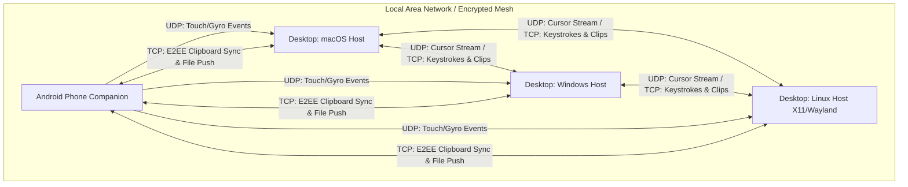
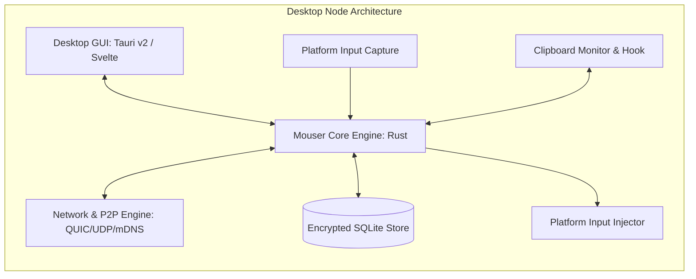
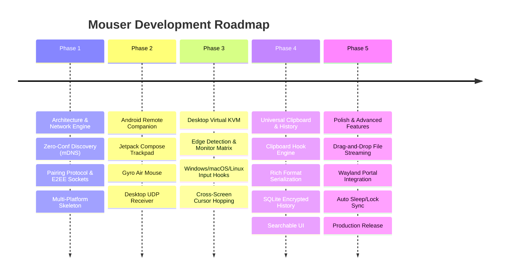

# Mouser: Unified Cross-Platform Virtual KVM & Universal Smart Clipboard
## Architectural Specification, Brainstorming & Implementation Roadmap

> **Target Platforms**: macOS (Apple Silicon / Intel), Windows 10/11, Linux (X11 & Wayland), Android (Mobile Companion & Input Device).

---

## 1. Executive Summary & Product Vision

**Mouser** is a next-generation, high-performance, open-source productivity system that unifies three traditionally fragmented utilities into one cohesive ecosystem:

1. **Virtual KVM Switch (ShareMouse / Synergy / Barrier alternative)**: Seamlessly glide your mouse cursor between multiple physical computers (macOS, Windows, Linux) across display borders, automatically redirecting keyboard and mouse inputs without physical hardware switches.
2. **Universal Smart Clipboard (Paste / Maccy / Ditto alternative)**: End-to-end encrypted, multi-device clipboard synchronization supporting plain text, rich text (HTML/RTF), images, snippets, and large file streams, accompanied by a searchable local history and privacy filters.
3. **Android Mobile Input & Control Hub**: Transforms any Android smartphone into a zero-latency wireless trackpad, 3D gyro air-mouse, media controller, macro pad, and mobile clipboard bridge.

### Core Design Principles
- **Ultra-Low Latency (<3ms LAN input lag)**: Input streaming must feel indistinguishable from hardware USB peripherals.
- **Zero-Configuration Discovery**: Automated peer discovery via mDNS / ZeroConf with cryptographic PIN / QR-code pairing.
- **Wayland-First on Linux**: Designed to work cleanly on modern Linux desktop environments (GNOME, KDE Plasma, wlroots) via standard portals and `uinput`, not just legacy X11.
- **Strict Privacy & Zero-Knowledge Security**: End-to-End Encryption (E2EE) with sensitive data masking (excluding passwords, credit cards, and credential vaults).
- **Lightweight Resource Footprint**: Written in native systems code (Rust) with tiny memory overhead (<30 MB RAM per machine).

---

## 2. Comprehensive Feature Matrix

### 2.1 Virtual KVM & Mouse/Keyboard Sharing (ShareMouse Capabilities)

| Feature | Description | Platform Support |
| :--- | :--- | :--- |
| **Seamless Edge Hopping** | Move cursor past screen boundary to seamlessly transition to an adjacent computer. | macOS, Win, Linux |
| **Visual Monitor Layout Matrix** | Visual canvas to arrange multi-monitor setups across distinct machines (e.g. 2 Macs + 1 Windows dual-screen). | macOS, Win, Linux |
| **DPI & Resolution Normalization** | Auto-compensates for mismatched resolutions (e.g. 4K Windows next to Retina MacBook next to 1080p Linux). | macOS, Win, Linux |
| **High-Polling Rate Smoothing** | Jitter-buffered packet queue for 500Hz - 1000Hz gaming mice without stutter or cursor dropping. | macOS, Win, Linux |
| **Key & Modifier Translation** | Bidirectional translation of platform-specific modifiers (`Command ⌘` $\leftrightarrow$ `Windows ⊞` / `Ctrl`, `Option ⌥` $\leftrightarrow$ `Alt`). | macOS, Win, Linux |
| **Edge Resistance & Lock** | Configurable cursor resistance at edges to prevent accidental boundary switching during gaming or window docking. | macOS, Win, Linux |
| **Hotkey Switch & Cursor Pin** | Dedicated hotkeys (e.g., `Ctrl + Ctrl` or `F13`) to instantly warp cursor to a target machine or lock to current screen. | macOS, Win, Linux |
| **Drag-and-Drop File Streaming** | Drag files from one screen, drag across border onto target machine desktop/folder with chunked streaming. | macOS, Win, Linux |
| **Synchronized Locking & Power** | Option to sync screen locking (`Win+L` / `Ctrl+Cmd+Q`), screensaver activation, and display sleep across all devices. | macOS, Win, Linux |
| **Shared Media & Volume Keys** | Forward global media control keys (Play, Pause, Next, Volume Up/Down) to designated host. | All |

---

### 2.2 Universal Smart Clipboard Engine

| Feature | Description | Platform Support |
| :--- | :--- | :--- |
| **Real-Time Cross-Device Sync** | Instant clipboard mirroring across all paired desktops and Android phones over encrypted local sockets. | macOS, Win, Linux, Android |
| **Multi-Format Payloads** | Supports Plain Text, Rich Text (HTML, RTF), Images (PNG, JPEG, WebP), Code Snippets, and File URI references. | macOS, Win, Linux, Android |
| **Encrypted Local History** | Persistent SQLite store with full-text search (FTS5) to search past clips by text, timestamp, or content type. | macOS, Win, Linux, Android |
| **Credential & Privacy Firewall** | Detects and excludes items from Password Managers (1Password, Bitwarden, KeePass, LastPass) and API keys/Credit Cards. | macOS, Win, Linux, Android |
| **Quick Paste Popup Ring** | System-wide overlay menu (invoked via hotkey like `Cmd+Shift+V` or `Win+V`) to browse and paste historical items. | macOS, Win, Linux |
| **Snippet Templates** | Reusable canned text templates with dynamic variables (`{{date}}`, `{{clipboard}}`, `{{cursor}}`). | macOS, Win, Linux |
| **Direct Push Mode** | Option to disable continuous automatic sync in favor of manual push (e.g. "Send selection to Mac"). | All |
| **Auto-Purge & Retention Rules** | Automated expiration for clipboard entries (e.g., purge after 1 hour, 24 hours, or 30 days). | All |

---

### 2.3 Android Mobile Companion Hub

| Feature | Description | Platform Support |
| :--- | :--- | :--- |
| **Multi-Touch Trackpad** | Smartphone touchscreen as a high-precision trackpad: 1-finger tap (left click), 2-finger tap (right click), 2-finger scroll, pinch zoom. | Android $\rightarrow$ Desktops |
| **3D Gyro / Air Mouse** | Turn the phone into a spatial presentation pointer using internal IMU (gyroscope + accelerometer) with click triggers. | Android $\rightarrow$ Desktops |
| **Virtual Keyboard & Speech-to-Text** | Use native Android keyboard and Gboard voice dictation to inject characters directly into desktop active window. | Android $\rightarrow$ Desktops |
| **Macro Pad & Custom Actions** | Configurable grid buttons (Elgato Stream Deck style) for application launch, window management, audio controls. | Android $\rightarrow$ Desktops |
| **Media & Volume Remote** | Dedicated remote interface for Spotify, YouTube, system volume, mute, and media navigation. | Android $\rightarrow$ Desktops |
| **Background Clipboard Sync** | Read/write Android clipboard via Accessibility Service or custom Input Method (IME) despite Android 10+ sandboxing. | Android $\leftrightarrow$ Desktops |
| **Quick Share Sheet Target** | Appear directly in Android native "Share with..." menu to send URLs, photos, or files straight to PC desktop. | Android $\rightarrow$ Desktops |
| **Battery & WiFi Diagnostics** | Show real-time connection status, round-trip ping time, and host computer vitals on the mobile screen. | Android |

---

### 2.4 Security, Discovery & Networking

| Feature | Description | Details |
| :--- | :--- | :--- |
| **Zero-Conf Local Discovery** | mDNS (Multicast DNS / Bonjour / Avahi) | Broadcasts `_mouser._tcp` and `_mouser._udp` on local subnet. |
| **Cryptographic Pairing** | 6-Digit PIN & QR-Code Exchange | Mutual authentication using ephemeral elliptic-curve Diffie-Hellman (X25519) + ChaCha20-Poly1305. |
| **Transport Layer Architecture** | Dual-Channel (UDP + TCP/QUIC) | - **UDP / QUIC Datagrams**: Mouse coordinates, gestures, scroll deltas (loss-tolerant, sub-millisecond).<br>- **TLS / QUIC Streams**: Keystrokes, clipboard payloads, file transfers (loss-sensitive, ordered). |
| **Zero-Knowledge Encryption** | E2EE for all payloads | Data in transit is encrypted end-to-end; no intermediate cloud server required or used by default. |
| **Cross-Subnet & VPN Support** | Manual IP / Port Direct Connect | Supports Tailscale, WireGuard, or custom static IP connections for machines across separate VLANs. |

---

## 3. High-Level Architecture & System Topology



### Component Architecture per Node



---

## 4. Platform-Specific Technical Implementation

### 4.1 macOS
- **Input Capture**: `CGEventTapCreate` (requires Accessibility permission via `TCC`). Intercepts `kCGEventMouseMoved`, `kCGEventLeftMouseDown`, `kCGEventKeyDown`, and raw trackpad gesture events.
- **Input Injection**: `CGEventPost` / `IOHIDEventCreateVirtualPointer` to inject mouse moves and keyboard strokes without cursor stutter.
- **Screen Geometry**: `NSScreen` framework with `NSApplicationDidChangeScreenParametersNotification` to monitor hot-plugging displays and Retina display coordinate scaling.
- **Clipboard Management**: `NSPasteboard` observing `changeCount` or using background timer polling at 200ms intervals.

### 4.2 Windows (10 & 11)
- **Input Capture**: Low-Level Hooks (`SetWindowsHookEx` with `WH_MOUSE_LL` and `WH_KEYBOARD_LL`) or Windows Raw Input (`RegisterRawInputDevices`) for zero-lag cursor capture.
- **Input Injection**: `SendInput` API and synthetic pointer injection (`InjectSyntheticPointerInput`).
- **Screen Geometry**: `EnumDisplayMonitors` with Per-Monitor DPI Awareness v2 (`GetDpiForMonitor`).
- **Clipboard Management**: `AddClipboardFormatListener` and listening to `WM_CLIPBOARDUPDATE` messages for instant, zero-poll notifications.

### 4.3 Linux (Dual X11 & Wayland Support)
- **The Wayland Challenge**: Wayland explicitly restricts arbitrary global background input interception and injection for security isolation.
- **Wayland Solutions**:
  - **Capture**: `xdg-desktop-portal` with `org.freedesktop.portal.InputCapture` and `org.freedesktop.portal.RemoteDesktop`.
  - **Injection**: Virtual input kernel device via `/dev/uinput` (`libevdev` in Rust), or compositor-specific protocols (e.g. `wlr-virtual-pointer-unstable-v1` on Sway/Hyprland).
- **X11 Solutions**: Traditional `XRecord` extension for event capture and `XTest` extension for synthetic event injection.
- **Clipboard Management**:
  - X11: `XFixesClipboard` event notifications.
  - Wayland: Wayland data-control portal or `wl-clipboard` interface.

### 4.4 Android
- **UI Framework**: Modern Kotlin + Jetpack Compose for fluid UI and low memory footprint.
- **Touch Sensor Capture**: Multi-touch handling via Compose `pointerInput` and raw `MotionEvent` tracking (sampling rate up to 120Hz/240Hz screen refresh).
- **Gyroscope & IMU**: Android `SensorManager` subscribing to `TYPE_ROTATION_VECTOR` or `TYPE_GYROSCOPE` for 6-axis air-mouse tracking.
- **Background Clipboard Handling**:
  - Android 10+ restricts background clipboard reading.
  - Solution: Dedicated **Accessibility Service** or custom lightweight **Input Method Service (IME)** allowing seamless background clipboard access and automatic desktop sync.
  - Quick Settings Tile: 1-tap "Push Clipboard to PC" toggle.

---

## 5. Network Protocol Specification

```
+-------------------------------------------------------------+
| Mouser Packet Header (8 Bytes)                              |
| - Magic: 'MOUS' (4 bytes)                                   |
| - Protocol Version: 1 byte (0x01)                           |
| - Packet Type: 1 byte (0x01: Motion, 0x02: Key, 0x03: Clip) |
| - Sequence ID: 2 bytes                                      |
+-------------------------------------------------------------+
| Payload (Encrypted with ChaCha20-Poly1305)                  |
| - Type 0x01 (Motion): DeltaX (i16), DeltaY (i16), Buttons   |
| - Type 0x02 (Key): KeyCode (u32), Modifiers (u8), State     |
| - Type 0x03 (Clipboard): MIME, Payload Length, Data Chunks  |
+-------------------------------------------------------------+
```

1. **Discovery Stage**: mDNS broadcasts announce presence (`_mouser._tcp.local` on port 58490).
2. **Pairing Handshake**:
   - Device A initiates TLS 1.3 handshake.
   - User verifies 6-digit cryptographic PIN or scans QR code on Android.
   - Symmetric auth key generated and stored in platform secure enclave (Keychain on macOS, DPAPI on Windows, SecretService on Linux, EncryptedSharedPreferences on Android).
3. **Operational Streaming**:
   - High-frequency mouse movements streamed over encrypted UDP / QUIC datagrams.
   - Low-frequency, high-reliability events (Keystrokes, Clipboard, File transfers) transmitted over encrypted TCP / QUIC streams with delivery acknowledgments.

---

## 6. Implementation Roadmap



### Phase 1: Core Networking, Protocol & Pairing (Weeks 1 - 3)
- [ ] Implement Rust networking crate with mDNS service discovery (`zeroconf` / `mdns-sd`).
- [ ] Define binary packet protocol (header, message types, serialization with `bincode`).
- [ ] Implement Noise Protocol / TLS 1.3 mutual handshake with 6-digit pairing PIN.
- [ ] Build basic CLI peer-to-peer ping and latency benchmarking tool.

### Phase 2: Android Companion & Remote Trackpad (Weeks 4 - 6)
- [ ] Setup Android Kotlin project with Jetpack Compose.
- [ ] Implement high-frequency touch gesture detector (tap, double tap, 2-finger scroll, drag).
- [ ] Implement Gyroscope / IMU fusion algorithm for 3D air-mouse pointer.
- [ ] Build desktop receiver prototype (injecting input via `enigo` or platform-native APIs).
- [ ] Verify sub-5ms round-trip latency over 5GHz Wi-Fi.

### Phase 3: Desktop Virtual KVM (ShareMouse Engine) (Weeks 7 - 10)
- [ ] Implement native input capture and injection drivers:
  - macOS: `CGEventTap` + `CGEventPost`
  - Windows: `SetWindowsHookEx` + `SendInput`
  - Linux: `uinput` kernel driver + X11 fallback
- [ ] Build dynamic multi-monitor layout coordinate transformer.
- [ ] Implement boundary detection and screen edge hopping logic.
- [ ] Add modifier key translation table (Cmd $\leftrightarrow$ Ctrl/Win).
- [ ] Implement edge friction/resistance and lock toggles.

### Phase 4: Universal Multi-Format Clipboard & History (Weeks 11 - 13)
- [ ] Implement clipboard change listeners across all platforms.
- [ ] Support format decoders: Plain Text, UTF-8, HTML, RTF, PNG images.
- [ ] Build encrypted local database using SQLite + SQLCipher with FTS5 search.
- [ ] Design Quick Paste overlay HUD (`Cmd+Shift+V` / `Win+V`) in Tauri v2.
- [ ] Implement privacy filter (detect 1Password, Bitwarden, KeePass, Credit Cards, API keys).
- [ ] Android clipboard sync integration (Accessibility Service & IME fallback).

### Phase 5: File Transfer, Wayland Support & Release (Weeks 14 - 16)
- [ ] Implement boundary drag-and-drop file streaming protocol with progress bars.
- [ ] Implement Linux `xdg-desktop-portal` InputCapture protocol for modern GNOME/KDE Wayland.
- [ ] Add synchronized screen locking and sleep signals.
- [ ] Performance profiling: ensure CPU idle usage < 0.2% and RAM < 30 MB.
- [ ] Packaging: macOS DMG/PKG, Windows MSIX/EXE, Linux AppImage/Flatpak/DEB, Android APK.

---

## 7. Recommended Technology Stack

| Layer | Choice | Rationale |
| :--- | :--- | :--- |
| **Core Engine** | **Rust** | Zero garbage-collection latency pauses (vital for 1000Hz mouse streaming), memory safety, excellent C-FFI for OS hooks. |
| **Desktop UI** | **Tauri v2** + **Svelte 5** | Produces tiny native executables (~15MB), low RAM usage, rich web UI capabilities for the monitor layout canvas and clipboard history. |
| **Mobile App** | **Kotlin + Jetpack Compose** | Direct access to Android sensor hardware (120Hz touch sampling, gyroscope) and background services without hybrid bridge latency. |
| **Networking** | **Quinn (QUIC) + Tokio** | Enables combined multiplexed streams (clipboard/files) and unreliable datagrams (mouse coordinates) over a single UDP socket. |
| **Local Store** | **SQLite (rusqlite) + SQLCipher** | Embedded, battle-tested, instant full-text search (FTS5), zero-knowledge encryption on disk. |

---

## 8. Brainstormed Value-Add Ideas (Differentiators)

1. **"Presentation Laser Pointer" Mode**: Hold down a button on the Android phone to project a virtual high-visibility laser spot or spotlight circle on any of your connected computer screens.
2. **Audio Follows Cursor**: Automatically switch default audio output device to whichever computer currently has the mouse focus.
3. **Cross-Computer Picture-in-Picture / Glance**: Hover your cursor near a screen edge to preview a live thumbnail stream of the target screen before hopping over.
4. **Shared Terminal Session**: Select a shell command on your Mac, hop cursor to Linux machine, and middle-click to execute directly in the target terminal.
5. **Smart Android Numpad / Macro Pad**: When cursor focuses on a spreadsheet (Excel / Google Sheets) on any computer, the Android screen automatically switches to a full numeric keypad or formula bar.
