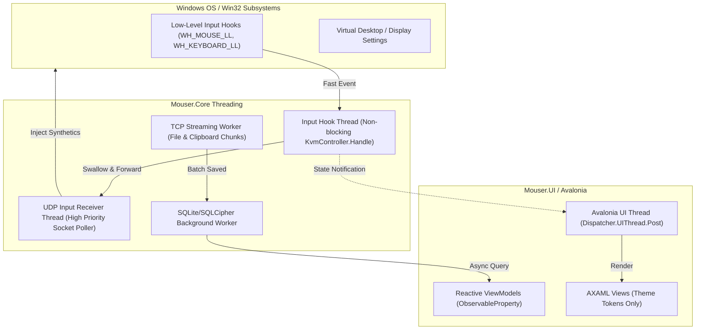

# Mouser System Architecture

Mouser is built on a clean, layered .NET 8 architecture designed for extreme responsiveness, absolute thread safety, and zero dependencies on external cloud services.

---

## 1. Project Organization & Dependency Rule

The solution is divided into four main projects:

```
                   +------------------------+
                   |     Mouser.Desktop     |  (Application Entry Point)
                   +-----------+------------+
                               |
                               v
                   +------------------------+
                   |       Mouser.UI        |  (Avalonia MVVM Views & ViewModels)
                   +-----------+------------+
                               |
                               v
                   +------------------------+
                   |      Mouser.Core       |  (Pure Logic, Crypto, Network, OS Hooks)
                   +------------------------+
```

### The Non-Negotiable Rule:
> **`Mouser.Core` NEVER references UI or Avalonia.**  
All core data structures, cryptographic primitives, geometry math, network receivers, and storage models remain 100% UI-agnostic and unit-testable in headless test runners.

---

## 2. Threading Model & Concurrency

Mouser coordinates several dedicated execution contexts to guarantee input responsiveness under heavy UI or network load:



### Thread Responsibilities
1. **Win32 Input Hook Thread:** Runs the low-level Windows message loop for `WH_MOUSE_LL` and `WH_KEYBOARD_LL`. Code in `KvmController.Handle` executes in microseconds, avoiding allocations and locks so cursor movement never hitches.
2. **UDP Receiver Thread:** High-priority loop processing 14-byte/51-byte datagrams, authenticating AEAD tags, checking the sliding replay window, and forwarding input to `IInputSink`.
3. **TCP Streaming Worker:** Asynchronously buffers chunked file transfers and clipboard payloads with SHA-256 integrity checks.
4. **UI Thread:** Owns the Avalonia UI visual tree. All background state transitions (devices appearing, clips received, toasts) communicate to the UI thread strictly via `Dispatcher.UIThread.Post`.

---

## 3. Subsystem Breakdown

### 1. KVM & Geometry Engine (`Mouser.Core.Kvm`, `Mouser.Core.Geometry`)
- **VirtualKvmManager:** Maps connected displays and peer placements in continuous coordinate space.
- **MoveCoalescer:** Batches sub-millisecond mouse moves into 2 ms intervals to prevent UDP socket saturation while preserving pixel-perfect smoothness.
- **Edge Resistance:** Evaluates push velocity to avoid accidental cursor jumps when reaching edge boundaries.

### 2. Cryptographic Security Engine (`Mouser.Core.Security`)
- **SessionCrypto:** Manages per-session AES-256-GCM authenticated encryption with a 64-slot sliding replay window.
- **SecretStore:** Uses Windows DPAPI (`DataProtectionScope.CurrentUser`) to secure stored pairing keys.
- **AppLockService:** PBKDF2 (600,000 iterations) key derivation, Base32 recovery keys, and progressive backoff timers (0s, 5s, 15s, 60s, 300s).

### 3. Smart Clipboard Engine (`Mouser.Core.Clipboard`)
- **ClipboardWatcher:** Tracks `GetClipboardSequenceNumber` with 150 ms polling and 1s fallback timer.
- **Storage & Search:** SQLite + SQLCipher with FTS5 virtual tables for instant search across tens of thousands of clips.
- **Privacy Filter:** Regex-based scrubbing for private keys, AWS tokens, GitHub PATs, Stripe keys, and credit cards.
