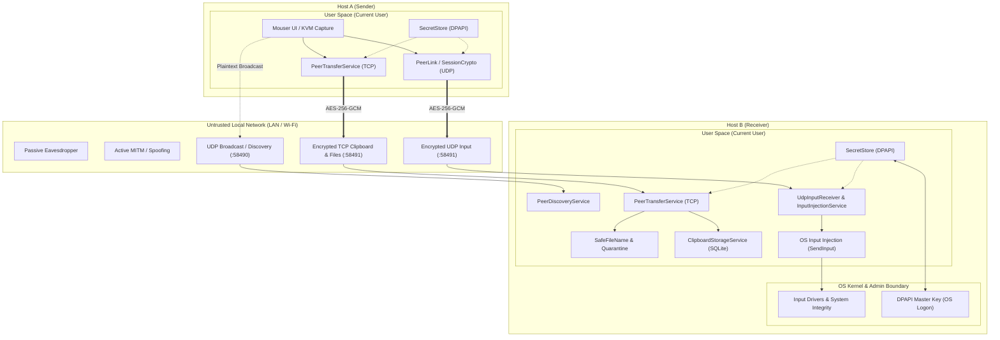

# Mouser Threat Model & Security Architecture

## 1. Executive Summary

Mouser is a cross-platform virtual KVM (keyboard, video, mouse) and data sharing suite connecting desktop PCs (Windows, macOS, Linux) and mobile devices (Android) over local area networks. Mouser enables seamless mouse transition across screen boundaries, synchronized typing/hotkeys, real-time multi-format clipboard sharing, and direct peer-to-peer file transfer.

Because Mouser controls low-level input injection and processes incoming network streams, its security architecture assumes an adversarial local network environment (e.g. public coffee shops, shared campus networks, or untrusted Wi-Fi). This document provides an exhaustive threat assessment using the **STRIDE** methodology, maps system trust boundaries, and defines the mitigations implemented in Protocol v2.

---

## 2. Trust Boundaries & Architecture

### Trust Boundary Definitions

1. **Local Network Boundary:**
   - All network interfaces (Wi-Fi, Ethernet, VPN virtual adapters) are treated as untrusted.
   - Attackers are assumed capable of sniffing packets, injecting arbitrary UDP/TCP traffic, replaying recorded traffic, and performing ARP/DNS poisoning.
2. **User-Space vs. Host OS Boundary:**
   - Mouser executes as a standard user process.
   - It trusts the underlying operating system kernel, cryptographic libraries (System.Security.Cryptography, CNG, OpenSSL), and the system clock.
   - It relies on OS-provided credential isolation (Windows DPAPI, Android Keystore).
3. **Paired vs. Unpaired Peer Boundary:**
   - Only peers that have completed the cryptographic out-of-band SAS pairing handshake are authorized to inject input or synchronize clipboard contents.
   - Unpaired devices broadcasting discovery beacons can only be observed in the UI; they cannot trigger actions on the host.

---

## 3. STRIDE Threat Analysis

### 3.1 Spoofing (Identity & Origin)

| Threat | Description | Mitigation in Mouser Protocol v2 |
| :--- | :--- | :--- |
| **Beacon Spoofing** | Rogue node broadcasts discovery beacons claiming a known `deviceId` from a malicious IP to hijack input links. | **Endpoint pinning & authentication:** `EnsureLink` ignores beacon endpoint updates for paired peers until a valid cryptographically authenticated datagram is received from the new endpoint. |
| **Peer Impersonation** | Attacker crafts UDP input packets claiming to be a paired peer. | **AEAD Tag & FNV-1a Hash:** Every datagram carries a 4-byte sender hash and a 16-byte AES-256-GCM tag. Without the shared `PairKey`, forged packets are rejected with 0 side-effects. |
| **MITM Key Exchange** | Attacker intercepts initial pairing handshake to substitute public keys. | **Out-of-band SAS Confirmation:** ECDH shared secret and public keys derive a 6-digit SAS code (`XXX XXX`). Users must visually verify code equality on both screens before keys are saved. |

### 3.2 Tampering (Data Modification)

| Threat | Description | Mitigation in Mouser Protocol v2 |
| :--- | :--- | :--- |
| **In-Flight Input Tampering** | Attacker alters mouse coordinates or keystrokes in transit. | **Authenticated Encryption:** AES-256-GCM verifies ciphertext integrity with a 128-bit authentication tag. Any modified bit causes immediate tag failure. |
| **File Chunk Alteration** | Attacker tampers with file transfer chunks in TCP stream. | **Dual Verification:** Each frame is authenticated with AES-256-GCM. Additionally, the complete file is validated against the sender's SHA-256 checksum upon completion. |
| **Path Traversal / Overwrite** | Malicious peer sends `../../Windows/System32/evil.dll` or alternate data streams (`a.txt:evil`). | **SafeFileName Sanitizer:** Traversal sequences, directory paths, ADS colons, Windows reserved device names (`CON`, `PRN`, `NUL`), and trailing dots/spaces are stripped or prefixed. Collisions generate unique names (`name (1).ext`). |

### 3.3 Repudiation

| Threat | Description | Mitigation in Mouser Protocol v2 |
| :--- | :--- | :--- |
| **Unlogged Malicious Input** | Peer sends malicious keystrokes; no trail exists for post-incident analysis. | **Activity Logging:** Structured activity log records category, timestamp, peer identity, and event metadata. |
| **Unauthorized File Drop** | Peer sends unexpected file without user authorization. | **Interactive File Prompt:** Main window displays a mandatory approval modal displaying sender device name, file name, and file size before download is accepted. |

### 3.4 Information Disclosure

| Threat | Description | Mitigation in Mouser Protocol v2 |
| :--- | :--- | :--- |
| **LAN Eavesdropping** | Attacker sniffs Wi-Fi to capture passwords typed across KVM or copied to clipboard. | **Complete Payload Sealing:** All mouse deltas, keystrokes, Unicode typing units, clipboard text, and file payloads are encrypted with AES-256-GCM. |
| **Key Extraction at Rest** | Attacker steals `settings.json` from disk or backup. | **DPAPI Encryption:** The 32-byte `PairKey` is encrypted via Windows DPAPI `CryptProtectData` (scoped to `CurrentUser`). The encrypted blob cannot be decrypted without the user's OS logon credentials. |
| **Clipboard History Snooping** | Unauthorized person uses unlocked PC while owner is away. | **Mouser AppLock:** Passphrase-protected lock screen conceals clipboard history, disables UI configuration, and locks out input. |

### 3.5 Denial of Service (DoS)

| Threat | Description | Mitigation in Mouser Protocol v2 |
| :--- | :--- | :--- |
| **UDP Flood / Fuzzing** | Attacker bombards port 58491 with high-frequency garbage. | **Constant-Time Verification:** Malformed packets fail fast at the 51-byte size check or AES tag check without allocating memory. Fuzz-tested with 2000+ random variations with 0 hangs. |
| **Pairing Window Flooding** | Attacker spam-requests pairings to exhaust resources or confuse the user. | **Rate-Limiting:** 3 pairing requests per minute per IP; 5-minute lockout after 3 consecutive rejections. Pairing window defaults to 2 minutes and is closed by default. |
| **Oversized TCP Streams** | Attacker sends a multi-gigabyte clipboard or file payload to exhaust RAM/disk. | **Strict Caps:** Clipboard text capped at 4 MB; single frames capped at 4 MB; incoming files checked against `MaxIncomingFileMB` prior to acceptance. |

### 3.6 Elevation of Privilege

| Threat | Description | Mitigation in Mouser Protocol v2 |
| :--- | :--- | :--- |
| **Malicious Executable Delivery** | Attacker transfers an executable (`.exe`, `.bat`, `.ps1`) that executes automatically. | **Quarantine & Mark-of-the-Web:** Default settings block hazardous extensions. Accepted executable files on Windows automatically receive `Zone.Identifier` ADS (`ZoneId=3`), ensuring Windows SmartScreen prompts the user before execution. |
| **UI Spoofing via Hook Interception** | Malicious local app tries to hijack Mouser keyboard/mouse hooks. | **Privilege Elevation (E18):** Mouser provides an optional "Run as Administrator" option to ensure hooks take precedence over lower-integrity processes. |

---

## 4. Threat Matrix & Residual Risks

| Adversary Profile | Capabilities | What Protocol v2 Protects | Residual Risk / Physical Limit |
| :--- | :--- | :--- | :--- |
| **Passive Sniffer** | Listens to Wi-Fi traffic. | Complete confidentiality of input, clipboard, files, and credentials. | Traffic analysis (timing and packet volume reveals active mouse motion or high-bandwidth transfers). |
| **Active MITM** | ARP spoofing, rogue access point. | Prevents tampering, injection, and session hijacking; detected by SAS code mismatch. | Network-level Denial of Service (attacker can drop or delay packets). |
| **Rogue LAN Device** | Sends unsolicited Mouser packets. | Packets discarded without shared key; pairing requests rejected unless user opened pairing window. | Subnet discovery broadcasts (`:58490`) reveal device existence and hostname. |
| **Lost / Stolen Laptop** | Physical access to disk when powered off. | Keys stored in DPAPI cannot be decrypted without OS login. | If user account has blank password or auto-login without AppLock, physical operator inherits user rights. |
| **Compromised Paired Device** | Full remote control of a previously paired computer. | Blast radius limited: can only send keystrokes and clipboard text; cannot traverse paths or overwrite arbitrary files. | Attacker can issue keystrokes (e.g. Win+R) as long as the device remains paired. User can revoke pairing anytime. |
| **Local Same-User Malware** | Malware executing in the same OS user session. | Mouser AppLock conceals UI and history. | Malware can inspect process memory, read unencrypted DPAPI keys while user is logged in, or use OS APIs (`SendInput`) directly. |
| **Local Administrator / Root** | Full control of the host operating system. | None (out of scope). | An elevated administrator or kernel driver has absolute control over OS memory, keystrokes, and security tokens. |

---

## 5. Security Verification & Testing Standards

All cryptographic and network handling routines in Mouser are backed by continuous automated test coverage:
1. **Fuzz Testing:** `FuzzTests.cs` runs deterministic 2000-iteration stress tests on all packet readers (`InputMotionPacket.TryRead`, `SecureInputPacket.TryRead`, `PeerDiscoveryService.TryParseBeaconPayload`, `PeerTransferService.ReadFrameAsync`, `ClipboardPayload.Deserialize`, and `SearchQuery.Parse`).
2. **Replay & Window Verification:** `SecureInputChannelTests.cs` validates that out-of-order, replayed, and corrupted datagrams fail decryption and are rejected.
3. **Traversal & Sanitization:** `PeerTransferTests.cs` verifies path traversal, Windows reserved names, alternate data streams, and size limits.
4. **Key Isolation:** `SecretStoreTests.cs` validates DPAPI round-trip protection, unprotect error recovery, and cross-platform fallbacks.
