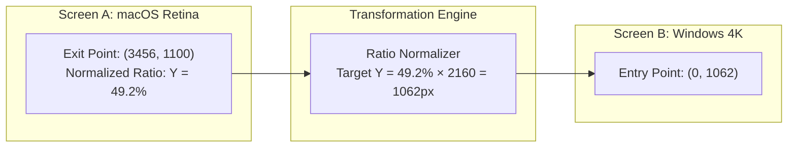

# Phase 4: Desktop Virtual KVM (ShareMouse Engine)

> **Objective**: Implement the desktop-to-desktop Virtual KVM engine allowing mouse cursor and keyboard inputs to transition seamlessly across physical machines (macOS, Windows, Linux) across display borders.

---

## 1. Low-Level Input Interception & Suppression

When the mouse hits a configured screen edge, the local OS must:
1. **Swallow / Suppress** local input events (so the local cursor stops at the edge and clicks do not affect local windows).
2. **Stream** movement deltas and keystrokes over the encrypted UDP/TCP socket to the target machine.
3. The target machine **injects** synthetic events into its native OS event queue.

### 1.1 macOS Input Tap (`platform_mac.mm`)
```objective-c
#import <ApplicationServices/ApplicationServices.h>

static bool g_isInputRedirected = false;

CGEventRef eventTapCallback(CGEventTapProxy proxy, CGEventType type, CGEventRef event, void *refcon) {
    if (!g_isInputRedirected) {
        // Normal local execution: check if cursor reached screen boundary
        if (type == kCGEventMouseMoved) {
            CGPoint loc = CGEventGetLocation(event);
            // Check boundary logic (e.g. reached right border of primary screen)
            if (loc.x >= g_rightBoundaryThreshold) {
                g_isInputRedirected = true;
                // Notify C# layer that transition occurred
                g_onBoundaryTriggeredCallback(loc.y);
                return NULL; // Swallow event
            }
        }
        return event;
    }

    // Input is currently redirected to remote screen: swallow local input and forward
    if (type == kCGEventMouseMoved) {
        int64_t dx = CGEventGetIntegerValueField(event, kCGMouseEventDeltaX);
        int64_t dy = CGEventGetIntegerValueField(event, kCGMouseEventDeltaY);
        g_onForwardMotionCallback((int16_t)dx, (int16_t)dy);
        return NULL; // Suppress local cursor
    }
    
    if (type == kCGEventLeftMouseDown || type == kCGEventLeftMouseUp) {
        bool isDown = (type == kCGEventLeftMouseDown);
        g_onForwardButtonCallback(1, isDown);
        return NULL;
    }

    if (type == kCGEventKeyDown || type == kCGEventKeyUp) {
        int64_t keycode = CGEventGetIntegerValueField(event, kCGKeyboardEventKeycode);
        bool isDown = (type == kCGEventKeyDown);
        g_onForwardKeyCallback((uint32_t)keycode, isDown);
        return NULL;
    }

    return event;
}
```

---

## 2. Multi-Monitor Coordinate Transformation & DPI Normalization

Different machines have different screen dimensions, pixel densities, and resolutions (e.g., a 16" MacBook Pro Retina $3456\times2234$ next to a 27" 4K Windows Monitor $3840\times2160$).



### 2.1 Coordinate Transformer (`CoordinateTransformationEngine.cs`)
```csharp
namespace Mouser.Core.Geometry;

public sealed class CoordinateTransformationEngine
{
    public static (int TargetX, int TargetY) CalculateEntryPosition(
        double sourceExitY, double sourceHeight,
        double targetWidth, double targetHeight,
        ScreenEdge targetEdge)
    {
        // 1. Calculate relative vertical percentage of exit point
        double verticalRatio = Math.Clamp(sourceExitY / sourceHeight, 0.0, 1.0);

        // 2. Project percentage onto target display height
        int targetY = (int)(verticalRatio * targetHeight);

        // 3. Position at entry edge (e.g. Left edge = 0)
        int targetX = targetEdge == ScreenEdge.Left ? 0 : (int)targetWidth;

        return (targetX, targetY);
    }
}
```

---

## 3. Keyboard & Modifier Key Translation

Modifier keys differ across operating systems:
- macOS `Command ⌘` maps to Windows `Control` (for shortcuts like Copy/Paste) or `Windows ⊞`.
- macOS `Option ⌥` maps to Windows `Alt`.

A bi-directional state table keeps track of active key states to avoid the "stuck modifier key" issue if a network drop occurs.

---

## 4. Phase 4 Implementation Steps

- [ ] **Step 4.1: Native Event Tap with Event Suppression**
  - Implement full event suppression on macOS (`CGEventTap`), Windows (`SetWindowsHookEx`), and Linux (`uinput`).
- [ ] **Step 4.2: Boundary Collision Detection**
  - Monitor local cursor position. When it reaches an active boundary, activate redirection mode.
  - Implement configurable edge resistance (cursor must push past edge for $X$ milliseconds to switch).
- [ ] **Step 4.3: Coordinate Normalization Engine**
  - Build DPI-aware coordinate mapping to ensure cursor enters adjacent screen at matching relative physical height.
- [ ] **Step 4.4: Modifier Key Translator**
  - Implement bi-directional key translation table with key-release timeouts.
- [ ] **Step 4.5: Hotkey Screen Pinning**
  - Add hotkey (e.g. `Double-Tap Ctrl` or `F13`) to lock cursor to the current screen during full-screen applications or gaming.

---

## 5. Phase 4 Deliverables & Exit Criteria

- [ ] Cursor smoothly exits macOS screen and appears immediately on Windows/Linux screen.
- [ ] Mouse clicks and typing register properly in remote active windows.
- [ ] Modifier keys (`Cmd+C` / `Ctrl+C`) function correctly across both operating systems.
- [ ] Cursor switches back instantly when dragged to the opposite border.
