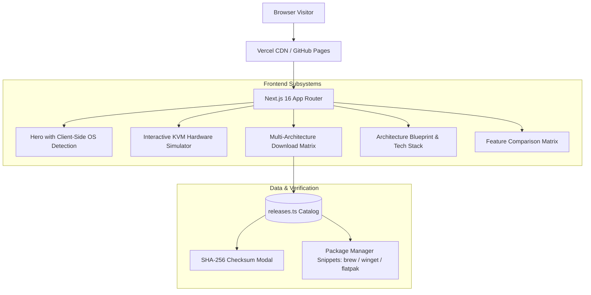

# Mouser Web: Engineering Roadmap & Implementation Plan

Welcome to the phased engineering roadmap for **Mouser Web** — the showcase landing portal and universal multi-platform download hub for Mouser.

Just like the core C#/.NET and native driver roadmap in `roadmap/`, this directory organizes the web project into structured, auditable phases detailing architecture blueprints, components, UI designs, and deployment configurations.

---

## Roadmap Navigation

| Phase | Title | Focus Area | Status |
| :---: | :--- | :--- | :---: |
| **[Phase 1](./phase-1-nextjs-architecture-and-tokens.md)** | **Next.js 16 App Router & Design System** | Scaffolding, Tailwind v4 tokens, Glassmorphism, Responsive shell | Completed |
| **[Phase 2](./phase-2-multi-platform-download-catalog.md)** | **Universal Multi-Platform Download Matrix** | OS detection, Architecture tabs, SHA256 modal, Package manager CLI | Completed |
| **[Phase 3](./phase-3-interactive-kvm-canvas-demo.md)** | **Live KVM & Clipboard Hardware Simulator** | Real-time multi-monitor canvas, cursor roaming physics, UDP diagnostics | Completed |
| **[Phase 4](./phase-4-ci-cd-vercel-and-github-pages.md)** | **Automated Deployment & CI/CD Pipeline** | Vercel production headers, GitHub Actions Pages workflow, static export | Completed |

---

## Technical Architecture Overview

---

## Key Performance & Quality Standards

1. **Lighthouse Score**: Target >95 on Performance, Accessibility, Best Practices, and SEO.
2. **Zero Hydration Mismatch**: Client-side detectors properly hydrated using React hooks.
3. **Cross-Browser Parity**: Verified on Safari, Chrome, Firefox, Edge, and Mobile Safari.
